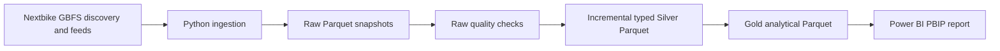

# CityBikeDataPlatform

A local data-engineering and analytics-engineering project for Wrocław
bike-sharing observations from Nextbike GBFS. Wrocław Open Data trip
ingestion is not implemented. See the [business summary](README_BUSINESS.md)
for stakeholder value, potential actions, and the portfolio story.

The implemented release is **local v1.0**: a Python pipeline collects GBFS
snapshots, preserves source data in Raw, incrementally materializes Silver,
builds analytical Gold Parquet tables, and supplies a Power BI PBIP report.
It does not collect trips or measure actual utilization.

## What is implemented

- Discovery and retrieval of six GBFS feeds: `vehicle_types`,
  `station_information`, `station_status`, `free_bike_status`,
  `system_regions`, and `system_pricing_plans`.
- Raw, one-row-per-feed-observation Parquet snapshots with source payload and
  observation metadata.
- Raw quality inspection, typed Silver tables, and nested child tables for
  station vehicle availability and pricing tiers.
- Restartable Raw-to-Silver processing based on a snapshot manifest and
  deterministic Silver-to-Gold projections.
- Ten Gold Parquet tables, including station, station/vehicle, free-bike, and
  system-snapshot facts for Power BI.
- A three-page Power BI report: System Overview, Station Analysis, and Bikes
  Analysis.
- Unit and integration tests plus Ruff lint and format checks.

This is a local portfolio implementation, not a production service. GBFS
snapshots describe observed system state; they are not trips, demand,
utilization, revenue, or customer data.

## Architecture and data flow



### Data layers

| Layer | Responsibility | Grain / behavior |
| --- | --- | --- |
| **Raw** | Preserve the GBFS envelope, provider payload, source URL, and application observation time. | One Parquet file and one row per feed observation; append-oriented. |
| **Silver** | Parse canonical `data_json` into typed columns and retain lineage. Normalize station vehicle-type availability and pricing tiers into child tables. | Entity plus `observed_at`; status observations remain time-varying. |
| **Gold** | Build dimensions and facts for report consumption, including localized calendar fields and system availability. | Snapshot-grain facts; a full deterministic projection from Silver is rebuilt on each run. |
| **Power BI** | Present system, station, and visible-bike availability patterns. | Imports Gold Parquet; its current Power Query expressions contain machine-specific absolute paths. |

`observed_at` is the canonical UTC observation identity. `observed_at_local`
is the same instant represented in `Europe/Warsaw` for local presentation and
calendar attributes. GBFS `last_updated` is provider metadata and is not the
collection timestamp.

## Data source and collection

The collector reads the Polish section of the Nextbike GBFS discovery feed:

`https://gbfs.nextbike.net/maps/gbfs/v2/nextbike_pl/gbfs.json`

It discovers the URLs for the six required feeds rather than constructing
feed URLs. Each successful feed response is validated and persisted under
`data/raw/<feed_name>/observed_at=<UTC timestamp>/snapshot.parquet`. The HTTP
client uses a 30-second default timeout and retries transient failures up to
three attempts. No API credentials are required by the current public endpoint.

The separate live smoke command retrieves and writes Raw data without
executing the full downstream pipeline:

```powershell
uv run python scripts/gbfs_live_smoke.py
```

## Requirements and installation

- Windows for the included Task Scheduler wrapper; Python code otherwise uses
  Python 3.11 or newer.
- `uv` for locked dependency installation and project commands.
- Network access to the public GBFS endpoint for ingestion.
- Power BI Desktop to open and refresh the report.

From the repository root:

```powershell
uv sync --locked --dev
```

The CI workflow currently validates Python 3.12. The package metadata still
declares version `0.1.0`; “local v1.0” describes the project milestone, not a
published Python package release.

## Run and validate

Run the complete one-shot pipeline from the repository root:

```powershell
uv run python scripts/run_pipeline.py
```

The coordinator performs GBFS ingestion, Raw quality checks, incremental
Raw-to-Silver processing, complete Silver-to-Gold projection, output row
counts, and completion-state update. A failed stage stops the run and returns
a non-zero exit status. It is a one-shot command, not a daemon; invoke it
manually or schedule it separately.

Other implemented commands:

```powershell
uv run python scripts/inspect_raw_quality.py
uv run python scripts/transform_incremental.py
uv run python scripts/transform_to_silver.py
uv run python scripts/transform_to_gold.py
uv run python scripts/validate_gold_schema.py
uv run python scripts/validate_gold_schema.py data/gold
```

`transform_incremental.py` transforms existing Raw data without ingestion or
the coordinator's Raw quality stage. The standalone Silver and Gold commands
are deterministic rebuild tools, not the normal incremental entrypoint.
`validate_gold_schema.py` accepts an optional Gold directory; its default is
`data/gold`. The scripts do not define additional CLI flags.

Run tests and code-quality checks:

```powershell
uv run pytest
uv run ruff check .
uv run ruff format --check .
```

## Incremental behavior, reruns, and quality

- Raw snapshot identity is `feed_name + observed_at`; Raw JSON content is
  hashed. An identical replay is idempotent, while conflicting content for an
  existing identity fails explicitly.
- `data/silver/_incremental_state.json` is a processed-snapshot manifest,
  not a time-only watermark. The pipeline processes unseen Raw snapshots and
  merges Silver rows on declared natural keys.
- Silver writes are staged and replaced only after all tables materialize;
  state is persisted after the commit. A failed stage leaves snapshots
  eligible for retry.
- Gold is recomputed as a deterministic full projection of all current
  Silver tables and staged before replacement.
- Gold joins related feed observations using nearest timestamps within a
  five-minute tolerance. Missing, ambiguous, or out-of-tolerance matches
  fail instead of being silently joined.
- Raw quality checks validate snapshot grain, schema, metadata, JSON, feed
  identifiers, and payload consistency. The coordinator stops on reported
  fatal errors.
- Generated Raw, Silver, Gold, and state files are local runtime data and
  are excluded from Git.

The incremental manifest and data are local operational state. Back them up
together if a local collection must survive machine loss; the current local
pipeline does not provide durable cloud storage or recovery.

For table grains and complete transformation details, see
[the architecture](docs/ARCHITECTURE.md),
[the Silver model](docs/SILVER_MODEL.md),
[the Gold model](docs/GOLD_MODEL.md), and
[incremental processing](docs/INCREMENTAL_PROCESSING.md).

## Power BI report

Open [Dashboard.pbip](dashboard/Dashboard.pbip) in Power BI Desktop. The report
contains System Overview, Station Analysis, and Bikes Analysis.

1. Install dependencies and run the complete pipeline so the Gold Parquet
   files exist.
2. Open `dashboard/Dashboard.pbip`.
3. Refresh the model in Power BI Desktop.

The semantic model currently references files under
`C:\Users\WIZBOX\Desktop\Projects\CityBikeDataPlatform\data\gold` through
absolute `File.Contents` paths in its Power Query expressions. Refresh on a
different checkout or computer requires changing those local paths; this
report is not portable by cloning alone. The free-bike map also applies
report-side location and vehicle-type filters. KPI definitions and known
semantic caveats are documented in
[Power BI analytics](docs/POWER_BI_ANALYTICS.md) and
[the semantic model guide](docs/POWER_BI_MODEL.md).

## Local Windows scheduling and logs

The repository includes
[run_local_pipeline.ps1](scripts/run_local_pipeline.ps1) and an exported
[Task Scheduler XML](<scripts/CityBikeDataPlatform - Local Pipeline.xml>).
The export is configured for an hourly repetition, starts the PowerShell
wrapper, and includes a machine-specific working directory and task principal.
The wrapper waits 30 seconds, invokes the project `.venv` Python executable,
and appends output to `logs/local_pipeline.log`. The task definition is not a
portable installer: review and adapt the account, absolute paths, and Python
environment before importing it on another machine. Whether the task is
currently registered or enabled is local Windows state and cannot be inferred
from the tracked XML alone.

The only repository GitHub Actions workflow is CI
([ci.yml](.github/workflows/ci.yml)); it runs tests and Ruff on pushes and pull
requests. There is no active GitHub Actions data-collection schedule.

## Repository layout

```text
dashboard/   Power BI PBIP report and semantic model
docs/        Architecture, source, model, operations, and KPI documentation
scripts/     Pipeline entrypoints, transformations, and Windows wrapper
src/         Python ingestion, storage, quality, and transformation modules
tasks/       Project status and future roadmap
tests/       Unit and integration tests
.github/     CI workflow
data/        Local Raw, Silver, and Gold runtime data (Git-ignored)
logs/        Local scheduler/pipeline logs (Git-ignored)
```

## Troubleshooting

| Symptom | Checks |
| --- | --- |
| `uv` command is unavailable | Install `uv`, open a new terminal, and retry `uv sync --locked --dev`. |
| GBFS request fails | Check network access and retry. HTTP errors, timeouts, invalid JSON, and invalid feed envelopes are surfaced; transient transport errors are retried. |
| Pipeline reports Raw quality errors | Run `uv run python scripts/inspect_raw_quality.py`; inspect the failing Raw snapshot before changing or deleting it. |
| Pipeline reruns old snapshots | Keep `data/silver/_incremental_state.json` with the Silver output. If state is missing, deterministic natural-key merging makes replay safe, but it may take longer. |
| Gold generation fails on temporal joins | Check that required feed observations exist and timestamps can be matched unambiguously within five minutes. |
| Power BI cannot find a Parquet file | Run the pipeline, then update the absolute `File.Contents` paths in the semantic model to the local `data/gold` directory. |
| Task Scheduler job fails | Check the task's user, working directory, `.venv\Scripts\python.exe`, script path, network availability, and `logs\local_pipeline.log`. |

## Version boundary and future work

Local v1.0 is the completed scope: GBFS snapshot ingestion, local Parquet
layers, incremental processing, data-quality validation, and a local Power BI
report. It does not implement authoritative trips, durable backups, cloud
storage, managed orchestration, secret management, alerting, or automated
cloud deployment.

For v2.0, I plan to evaluate cloud storage, compute and orchestration,
identity and secrets, monitoring and cost controls, Power BI connectivity,
and CI/CD while preserving the Raw/Silver/Gold boundaries. I have not
implemented these changes or selected specific cloud services yet. I also
plan to keep using GitHub for source code, documentation, pull requests, and
CI/CD if I move the runtime and data to cloud services. See
[my v2.0 roadmap](tasks/ROADMAP.md) and
[the recruiter-facing project overview](docs/PROJECT_OVERVIEW.md).
