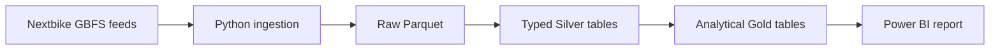
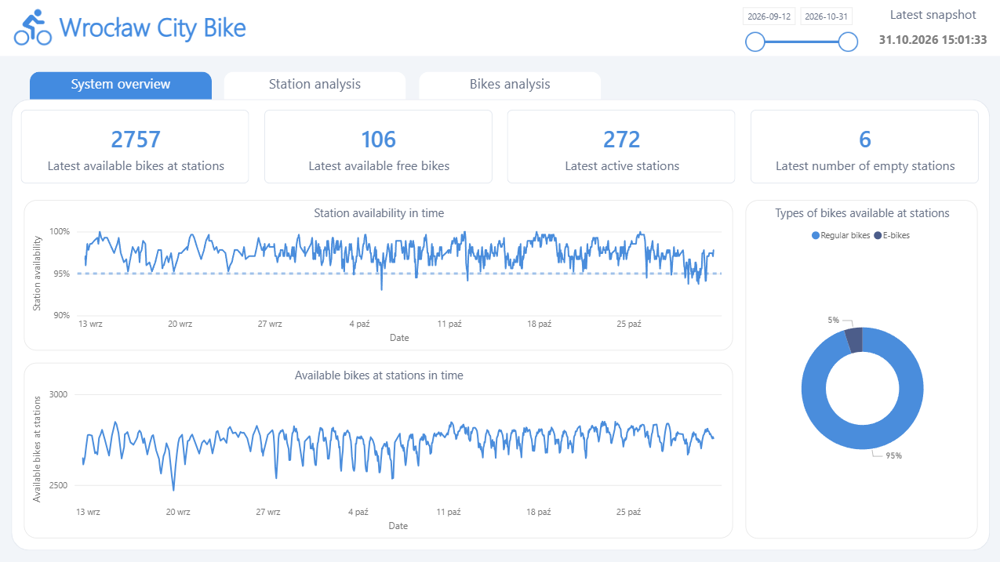
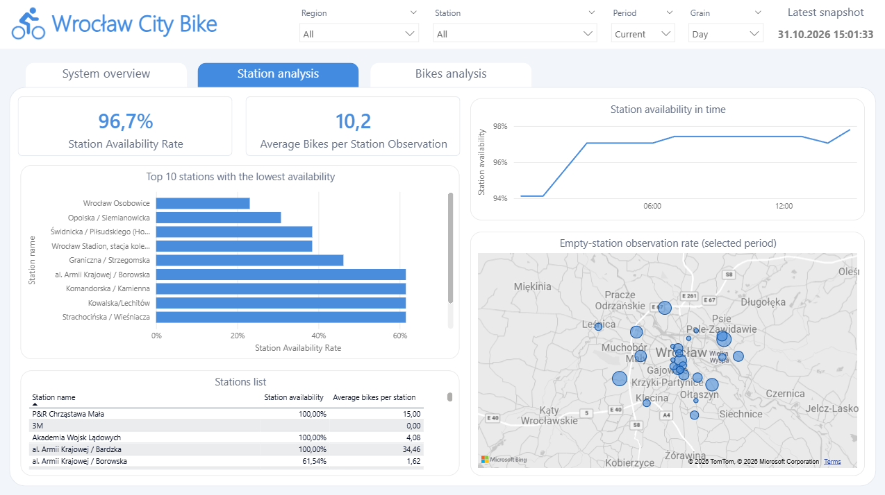
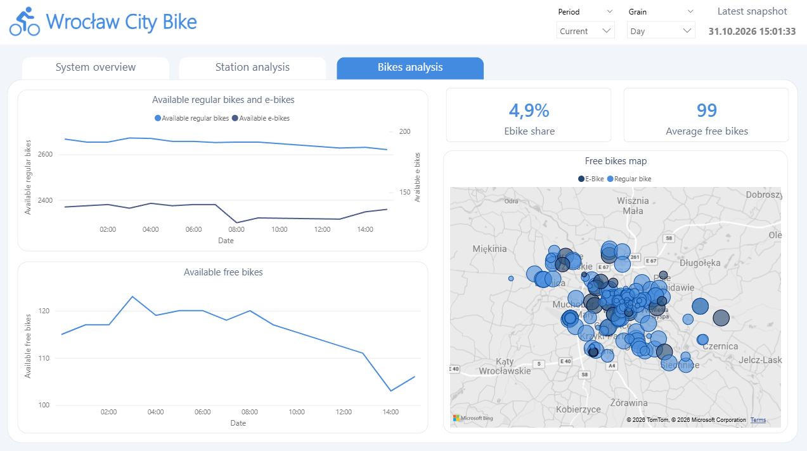

# CityBikeDataPlatform — Business Summary

## 📌 Project Overview

CityBikeDataPlatform is a local data and analytics project built around
Wrocław bike-sharing observations published through Nextbike GBFS feeds.
I built an end-to-end pipeline that preserves these observations, turns them
into analytical datasets, and presents availability patterns in a three-page
Power BI report.

The project is intended to show how public operational data can help a city,
the Wrocław City Bike team, and Nextbike identify locations worth a closer
look. It is an analytical prototype, not a production decision system, and it
does not claim measured financial or operational impact.

## 🎯 Analytical Goal

**Main question:**

How can repeated bike-sharing snapshots help identify station availability
patterns and locations that may deserve operational or on-site investigation?

The project turns a sequence of live system states into a historical view:
where bikes were reported at stations, which observed station records had no
bikes, and where the feed reported bikes without a station association.

## 🤝 Who Could Use It

### City of Wrocław / Municipal Engineering Department

- Compare observed station availability across selected areas and periods.
- Identify locations for an on-site review or a discussion with the operator.
- Use recurring out-of-station observations as one input when reviewing
  station placement and public-space needs.
- Establish an analytical baseline that could later be enriched with
  authoritative trip, infrastructure, and planning data.

The report can help prioritize questions and investigations. GBFS snapshots
alone do not establish demand, justify a new station, or explain why a station
was empty.

### Wrocław City Bike operations team

- Review stations with repeated zero-bike observations.
- Compare station states across times and locations.
- Check whether bikes reported without a station association repeatedly appear
  in the same areas.
- Design a limited replenishment or relocation pilot and compare observations
  before and after it.

These are possible workflows, not automatic recommendations from the current
report. The current data does not contain dispatch records, user reports, or
the reasons behind a bike's state.

### Nextbike

- Use the report as a shared conversation starter with the city and local
  operations team.
- Identify observations that could be checked against operational knowledge
  such as planned relocations, maintenance, or station capacity.
- Explore a future joint evaluation using richer operational or trip data.

The project does not assess Nextbike's contractual performance, service
quality, profitability, or customer demand. Those require agreed definitions
and additional data.

## 📍 Initial Locations to Investigate

My preliminary review of collected observations identified these stations
for closer analysis of recurring zero-bike states:

1. Kosmonautów / Fieldorfa, szpital wojewódzki
2. Kołłątaja / Podwale
3. 3M
4. Gajowicka
5. Aleja Bielany

I also noted areas where `free_bike_status` observations had no `station_id`.
These may be useful candidates for a map and on-site review of parking and
station coverage:

- Around ul. Kwiatkowskiego
- ul. Wyścigowa
- Around ul. Balonowej
- Wrocławski Park Przemysłowy (buildings B1/D1)
- ul. Tęczowa
- ul. Mieszczańska (Kępa Mieszczańska)
- Around Kromera stop (Czajkowskiego)

These lists are hypotheses to validate, not proof that the locations are
consistently empty, have unmet demand, or need a new station. Before acting,
I would compare empty observations with each station's total observed
snapshots, check time coverage and time-of-day patterns, and validate
out-of-station locations with the operator and a field visit. A blank
`station_id` means only that the feed did not associate that bike with a
station.

## 💡 Actions the Analysis Could Inform

1. **Test station replenishment.** Agree a short pilot at selected
   zero-availability stations, define comparison locations and success
   measures with the operator, and compare equivalent time windows before
   and after the change.
2. **Review out-of-station clusters.** Validate map locations, parking
   conditions, public-space constraints, and proximity to existing stations
   before considering a new station or another parking arrangement.
3. **Run a joint city-operator review.** Confirm the data coverage and KPI
   definitions, select a small number of locations, and decide whether
   additional operational data or an on-site inspection is needed.
4. **Enrich a future evaluation.** If authoritative trip history, relocation
   records, or incident data becomes available, combine it with snapshots to
   test whether observed patterns align with trips, interventions, or
   operational events.

The current prototype is a starting point for these investigations, not a
dispatch tool or an automated station-planning system.

## 🗄️ Data Source & Architecture

**Implemented source:**

- Nextbike GBFS discovery feed for the Polish system, used to find six
  required feeds:
  `station_information`, `station_status`, `free_bike_status`,
  `vehicle_types`, `system_pricing_plans`, and `system_regions`.
- The collector preserves each feed response as a Raw Parquet observation,
  including source payload and collection timestamp.

Wrocław Open Data trip ingestion is not implemented. GBFS provides periodic
system snapshots, not authoritative completed trips.

**Architecture:**

- Python discovers, retrieves, validates, and stores the GBFS observations.
- Raw preserves source snapshots for audit and reprocessing.
- Silver parses typed records and retains source lineage.
- Gold builds dimensional and snapshot-fact tables for analysis.
- Power BI imports Gold Parquet and presents the report.

## 🧱 Data Model

### Raw layer

- One Parquet file with one row per feed observation.
- Preserves provider metadata, source URL, `observed_at`, and raw JSON
  payloads.

### Silver layer

- Typed feed tables retain snapshot history and source lineage.
- Nested station vehicle-type availability and pricing tiers are modeled as
  separate child tables.
- Incremental state tracks processed feed observations for safe reruns.

### Gold layer

- Snapshot dimensions for stations, vehicle types, regions, and pricing.
- `fact_station_availability` — one station state per station and
  observation timestamp.
- `fact_station_vehicle_type_availability` — one station/vehicle-type count
  per timestamp.
- `fact_free_bike_snapshot` — one publicly visible bike state per timestamp.
- `gold_system_availability` — system-level counts for each station-status
  observation timestamp.

`observed_at` is the canonical UTC observation identity. Local calendar
attributes use the `Europe/Warsaw` representation of that instant. Feed
observations are collected sequentially and can have slightly different
timestamps; Gold aligns related observations within a five-minute tolerance.

## 📊 Analytics & Insights

The Power BI report has three pages:

- **System Overview** — latest system snapshot cards and trends for station
  bikes, empty stations, station counts, and bikes reported outside stations.
- **Station Analysis** — station availability comparisons and trends with
  date, period, station, and region context.
- **Bikes Analysis** — station e-bike composition, outside-station bike
  observations, snapshot trends, and a filtered bike map.

Potential analysis includes:

- frequency and share of observed station snapshots with zero bikes;
- station availability by selected date, time, or region;
- changes in observed station-bike counts between snapshots;
- e-bike share of station-bike observations;
- recurring areas with bikes whose feed records have no station association.

These metrics describe collected observations, not the percentage of time a
station was empty, customer demand, completed rides, utilization, or
causality. The Power BI map applies latitude and vehicle-type filters. Some
KPI definitions also have known null-handling and naming caveats; see
[Power BI KPI semantics](docs/POWER_BI_ANALYTICS.md) before interpreting
results as formal operational measures.

## 📸 Dashboard Preview

The report is included as a Power BI project at
[dashboard/Dashboard.pbip](dashboard/Dashboard.pbip).

## 🎥 Dashboard Demo

## 🛠️ Tech Stack

- **Python** — GBFS ingestion, validation, and pipeline coordination
- **PyArrow / Parquet** — local Raw, Silver, and Gold storage
- **Power BI / DAX** — semantic model, measures, and interactive report
- **pytest** — unit and integration testing
- **Ruff** — linting and formatting checks
- **GitHub Actions** — CI for tests and code-quality checks
- **Windows Task Scheduler** — optional local hourly execution via the
  repository's machine-specific task export

The project does not currently use DuckDB, dbt, Docker, Airflow, or cloud
services.

## 🧠 Skills Demonstrated

- Discovering and consuming a public API, validating responses, and handling
  transient HTTP failures.
- Preserving raw data and separating ingestion, storage, transformation, and
  presentation.
- Defining table grain, keys, lineage, and UTC/local timestamp semantics.
- Building idempotent incremental transformations with restartable state and
  staged output commits.
- Adding data-quality checks and testing pipeline failure/restart behavior.
- Designing dimensional and snapshot-fact models for Power BI.
- Translating operational questions into carefully scoped metrics and
  documenting their limitations.
- Maintaining CI and reproducible local project commands.

## ⚠️ Scope & Limitations

- This is a local portfolio prototype, not a production deployment.
- There is no authoritative trip, demand, customer, fare, revenue, or
  utilization analysis.
- Data and pipeline state are local; durable cloud storage, backup, monitoring,
  and alerting are not implemented.
- The Windows schedule and Power BI source paths require local configuration.
- Bikes reported outside stations are not necessarily incorrectly parked.
- A sequence of snapshots cannot establish why a station was empty or whether
  a pilot caused a change.

For reproducible setup and commands, see the [technical README](README.md).
For the detailed stakeholder context and v2.0 plans, see
[the project overview](docs/PROJECT_OVERVIEW.md).
